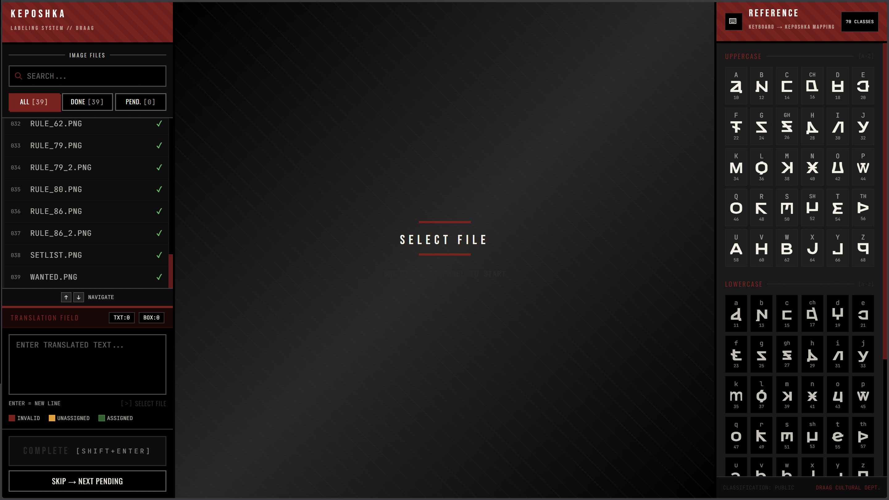

# Keposhka Labeler

Labeling tool for images of the fictional "Keposhka" language. Draw bounding boxes around characters and write the translation - the app automatically assigns letters to boxes using intelligent spatial ordering (left-to-right, top-to-bottom).



## Features

**Intelligent Labeling**
- Draw bounding boxes with mouse drag or quick click to repeat the last size
- Automatic character assignment using spatial ordering algorithm
- Automatic digraph detection (CH, GH, SH, TH) when typing or drawing boxes
- Real-time validation with text highlighting (invalid in red, unassigned in amber)
- Visual feedback on boxes (green = assigned, red dashed = unassigned)
- Line tolerance slider (0.3x-5.0x) for text in arcs or with height variation

**Interactive Canvas**
- Zoom and pan with mouse wheel or keyboard shortcuts (+/-, Ctrl+Drag)
- Resize and move boxes with transformation handles
- Box visibility toggle (V key) to see the original image
- Quick click indicator shows last box dimensions in red

**Workflow Management**
- Filter images by status (all/pending/completed)
- Search images by filename
- Keyboard shortcut navigation
- Two save modes: "Complete" (Shift+Enter) marks as finished, "Save Pending" saves draft
- Auto-advance to next pending image after saving

**Keposhka Alphabet**
- Interactive reference panel with 70 valid characters (0-9, A-Z, case-sensitive digraphs)
- Character insertion with click at cursor position
- Complete alphabet validation with real-time highlighting

## Tech Stack

### Backend
- **FastAPI** - Modern Python web framework
- **Uvicorn** - ASGI server
- **Pillow** - Image processing
- **uv** - Python package manager

### Frontend
- **React 19** + **TypeScript** - UI framework
- **Vite 7** - Build tool and development server
- **Tailwind CSS 3** - Utility-first styles
- **react-konva** - Canvas for drawing and manipulation
- **Zustand** - State management
- **Zod** - Schema validation
- **Bun** - JavaScript package manager

## Project Structure

```
keposhka_labeling/
├── backend/
│   ├── main.py              # FastAPI application
│   ├── schemas.py           # Pydantic models
│   ├── utils.py             # YOLO export utilities
│   ├── pyproject.toml       # Python dependencies
│   └── data/
│       ├── images/          # Source images to annotate
│       ├── annotations/     # Generated .txt (YOLO) and .json files
│       └── reference/       # Keposhka alphabet reference
│
└── frontend/
    ├── src/
    │   ├── components/
    │   │   ├── canvas/
    │   │   │   ├── StageBoard.tsx      # Main canvas component
    │   │   │   ├── BoxTransformer.tsx  # Resize/transformation
    │   │   │   └── UrlImage.tsx        # Image loader
    │   │   ├── EditorPanel.tsx         # Side panel with text input
    │   │   ├── ReferencePanel.tsx      # Right panel with alphabet
    │   │   └── BoxContextMenu.tsx      # Context menu for digraphs
    │   ├── lib/
    │   │   ├── sorter.ts               # Spatial ordering algorithm
    │   │   ├── validator.ts            # Keposhka alphabet validator
    │   │   ├── schemas.ts              # Zod validation schemas
    │   │   └── types.ts                # TypeScript type definitions
    │   └── store/
    │       └── useStore.ts             # Zustand state management
    ├── package.json
    └── vite.config.ts                  # Vite config with API proxy
```

## Installation

### Step 1: Install System Dependencies

You'll need to install **only 3 tools** (uv will install Python automatically):

#### 1. uv (Python package manager)
**Windows**: Open PowerShell (search for it in the Start menu) and run:
```bash
powershell -ExecutionPolicy ByPass -c "irm https://astral.sh/uv/install.ps1 | iex"
```

**macOS/Linux**: Open Terminal and run:
```bash
curl -LsSf https://astral.sh/uv/install.sh | sh
```

After installing, **close and reopen** the terminal for the command to be recognized. Verify with: `uv --version`

> **Note**: uv will automatically install Python 3.13+ the first time you run `uv sync`, you don't need to install it manually.

More info: [github.com/astral-sh/uv](https://github.com/astral-sh/uv)

#### 2. Node.js 18+
- **Windows/macOS**: Download and install the installer from [nodejs.org](https://nodejs.org/) (the installer will guide you through the process)
- **macOS with Homebrew**: `brew install node`
- **Linux (Ubuntu/Debian)**:
  ```bash
  curl -fsSL https://deb.nodesource.com/setup_lts.x | sudo -E bash -
  sudo apt-get install -y nodejs
  ```

Verify with: `node --version` (close and reopen the terminal after installing)

#### 3. Bun (JavaScript package manager)
**Windows**: Open PowerShell and run:
```bash
powershell -c "irm bun.sh/install.ps1|iex"
```

**macOS/Linux**: Open Terminal and run:
```bash
curl -fsSL https://bun.sh/install | bash
```

After installing, **close and reopen** the terminal. Verify with: `bun --version`

More info: [bun.sh](https://bun.sh)

### Step 2: Set Up Backend

Open a terminal in the project folder and run:

```bash
cd backend

# Install dependencies (first time only)
uv sync

# Run development server
uv run uvicorn main:app --reload
```

You'll see messages indicating the server is running. **Leave this terminal open** while using the application.

The backend will be available at `http://127.0.0.1:8000`

### Step 3: Set Up Frontend

**Without closing the previous terminal**, open a **second terminal** in the same project folder and run:

```bash
cd frontend

# Install dependencies (first time only)
bun install

# Run development server
bun run dev
```

You'll see a message with the URL to open the application. **Keep both terminals open** while using the application.

The frontend will be available at `http://localhost:5173`

### Quick Verification

Once both servers are running:
1. Open `http://localhost:5173` in your browser
2. You should see the labeler interface
3. Place some images in `backend/data/images/` to start labeling

> **Note**: New images are detected automatically without restarting servers. If you add images while the app is open, simply refresh the browser page (F5) or change a filter to reload the image list.

### Production Build

```bash
cd frontend

# Optimized production build
bun run build

# Preview production build
bun run preview
```

## Usage Guide

### Basic Workflow

1. **Add Images**: Place your Keposhka images in `backend/data/images/`
2. **Start Servers**: Run both servers (backend and frontend)
3. **Open App**: Navigate to `http://localhost:5173`
4. **Select Image**: Click on an image from the left panel list
5. **Draw Boxes**: Click and drag on canvas to create bounding boxes
6. **Write Translation**: Enter text or click characters from right panel to insert
7. **Auto-Assignment**: Labels and digraphs are automatically assigned in reading order
8. **Adjust Tolerance**: Use top-left slider if text is in an arc (high values = more tolerant)
9. **Save**: "Complete" (`Shift+Enter`) finalizes, "Save Pending" saves draft

### Keyboard Shortcuts

| Shortcut | Action |
|----------|--------|
| `Drag` | Draw new bounding box |
| `Click` | Create box with last dimensions (red indicator) |
| `Delete` / `Backspace` | Delete selected box |
| `Esc` | Deselect box |
| `Right Click` | Open digraph menu (set charCount) |
| `Shift+Enter` | Save and advance to next image |
| `Ctrl+Drag` | Pan canvas |
| `Mouse Wheel` | Zoom in/out |
| `+` / `-` | Zoom in/out |
| `0` | Reset zoom to 100% |
| `V` | Toggle box visibility |
| `Arrows` | Navigate between images |

### Working with Digraphs

Digraphs (`CH`, `ch`, `GH`, `gh`, `SH`, `sh`, `TH`, `th`) are automatically detected when:
- Drawing new boxes
- Writing or editing text in the translation field
- Inserting characters from the reference panel

For manual adjustment:
- Right-click on a box to open the context menu
- Select character count (1, 2, or 3)
- A red badge will appear showing the count

### Image States

- **Pending** (gray) - Not yet completed or saved as draft
- **Completed** (green) - Fully annotated and saved

Filter images using the status dropdown in the left panel.

## API Endpoints

| Endpoint | Method | Description |
|----------|--------|-------------|
| `/api/images` | GET | Lists all images with status and dimensions |
| `/api/annotations/{filename}` | GET | Gets existing annotation for an image |
| `/api/save` | POST | Saves annotation (YOLO + JSON) |
| `/health` | GET | Health check |
| `/images/{filename}` | GET | Serves static image files |

## Output Format

For each annotated image, two files are generated in `backend/data/annotations/`:

### 1. YOLO Format (`.txt`)
Used for model training. Only generated when status is "done".

```
class_id x_center y_center width height
```

All coordinates are normalized (range 0-1).

Example:
```
10 0.5234 0.3125 0.0260 0.0556
42 0.5703 0.3125 0.0234 0.0556
```

### 2. JSON Metadata (`.json`)
Used for re-editing. Always generated (drafts and completed).

```json
{
  "filename": "image001.jpg",
  "translatedText": "Hello world",
  "imageWidth": 1920,
  "imageHeight": 1080,
  "status": "done",
  "boxes": [
    {
      "id": "uuid-here",
      "x": 100,
      "y": 50,
      "width": 30,
      "height": 40,
      "charCount": 1,
      "label": "H"
    }
  ]
}
```

### 3. Classes File (`classes.txt`)
Auto-generated on backend startup with the 70 Keposhka characters.

## Sorting Algorithm

The spatial sorting algorithm (`sorter.ts`) works as follows:

1. **Row Detection**: Groups boxes into horizontal rows using dynamic threshold (70% of average height × tolerance multiplier)
2. **Left-to-Right Sorting**: Sorts boxes within each row by X coordinate
3. **Character Assignment**: Consumes characters from translated text (skipping spaces)
4. **Digraph Detection**: Automatically detects digraphs and sets `charCount=2` when appropriate
5. **Validation**: Ensures total characters match total box capacity

Visual feedback:
- **Green border**: Box with assigned label
- **Red dashed border**: Unassigned box (unbalanced state)
- **Red text**: Invalid characters in translation field
- **Amber text**: Characters not assigned to boxes

## Troubleshooting

**Backend won't start:**
- Verify that `uv` is installed correctly (run `uv --version`)
- If uv fails to install Python, install it manually from [python.org](https://www.python.org/downloads/) (needs 3.13+)

**Frontend won't start:**
- Verify that Bun is installed: `curl -fsSL https://bun.sh/install | bash`
- Clean node_modules: `rm -rf node_modules && bun install`

**Images won't load:**
- Verify images are in `backend/data/images/`
- Verify backend server is running on port 8000
- Check browser console for CORS errors

**Boxes don't align:**
- Images auto-fit to canvas with correct coordinate transformation
- Zoom/pan state resets when changing images

## License
MIT

## Acknowledgments
- Wyatt Kennedy for creating [Keposhka Regular Font](https://www.1001fonts.com/keposhka-regular-font.html)
